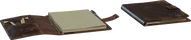
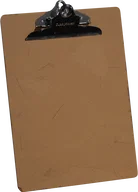
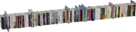
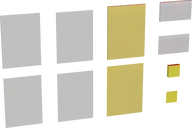
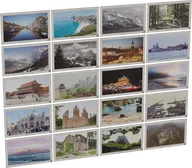
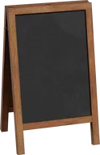
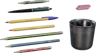
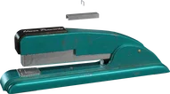

# Poly Haven: Office & Stationery models

**9 assets from [Poly Haven](https://polyhaven.com), dedicated to the public domain under [CC0](https://polyhaven.com/license).** Use them in any game, free or paid, and change them however you like; no credit is needed.

3D models as glTF at 1K and 2K texture resolution, each folder self-contained (`.gltf`, `.bin`, `textures/`). 64.9 MB in all.

This is a copy kept by [zuujis-cc0](https://github.com/zuujis-cc0) so game makers can take single files from GitHub. It is not made by or affiliated with Poly Haven: the originals, in more formats and higher resolutions, are on [polyhaven.com](https://polyhaven.com). If they help you, consider [supporting Poly Haven](https://www.patreon.com/polyhaven/overview).

Every file is listed in [MANIFEST.tsv](MANIFEST.tsv) with its size and SHA-256. More free assets: [the collection](https://github.com/zuujis-cc0/free-game-assets#readme).

| | | | |
| :-: | :-: | :-: | :-: |
|  <b><a href="binder_notebook">Binder Notebook</a></b> by DaDrood · <a href="https://polyhaven.com/a/binder_notebook">source</a> |  <b><a href="book_encyclopedia_set_01">Book Encyclopedia Set 01</a></b> by John Malcolm · <a href="https://polyhaven.com/a/book_encyclopedia_set_01">source</a> |  <b><a href="clipboard">Clipboard</a></b> by ProgrammerOnCoffee · <a href="https://polyhaven.com/a/clipboard">source</a> |  <b><a href="decorative_book_set_01">Decorative Book Set 01</a></b> by James Ray Cock · <a href="https://polyhaven.com/a/decorative_book_set_01">source</a> |
|  <b><a href="office_notepads">Office Notepads</a></b> by Ulan Cabanilla · <a href="https://polyhaven.com/a/office_notepads">source</a> |  <b><a href="postcard_set_01">Postcard Set 01</a></b> by James Ray Cock, Jurita Burger · <a href="https://polyhaven.com/a/postcard_set_01">source</a> |  <b><a href="standing_chalkboard_01">Standing Chalkboard 01</a></b> by ParzivalCG · <a href="https://polyhaven.com/a/standing_chalkboard_01">source</a> |  <b><a href="stationery_supplies">Stationery Supplies</a></b> by Mateusz Sadek · <a href="https://polyhaven.com/a/stationery_supplies">source</a> |
|  <b><a href="vintage_stapler">Vintage Stapler</a></b> by Mateusz Sadek · <a href="https://polyhaven.com/a/vintage_stapler">source</a> |  |  |  |

---

Updated automatically by [cc0-mirror](https://github.com/zuujis-cc0/cc0-mirror). Something wrong? [Open an issue there](https://github.com/zuujis-cc0/cc0-mirror/issues/new) or use the [private report form](https://games.zuujis.com/report).
